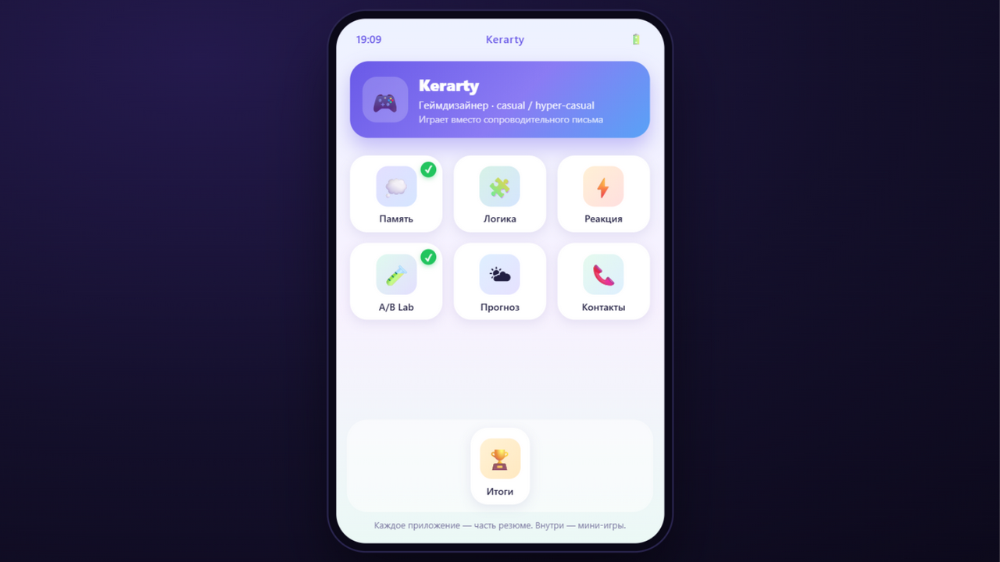
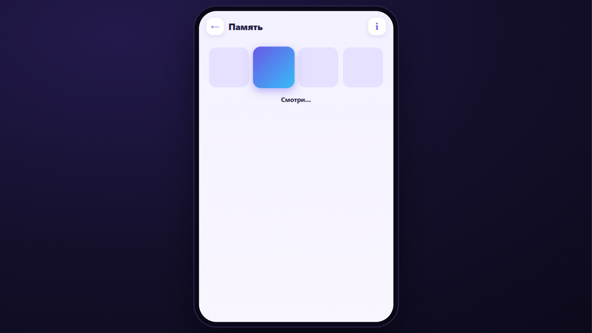
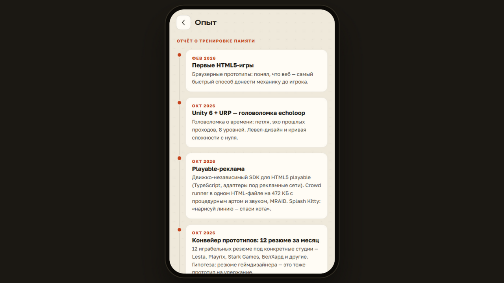
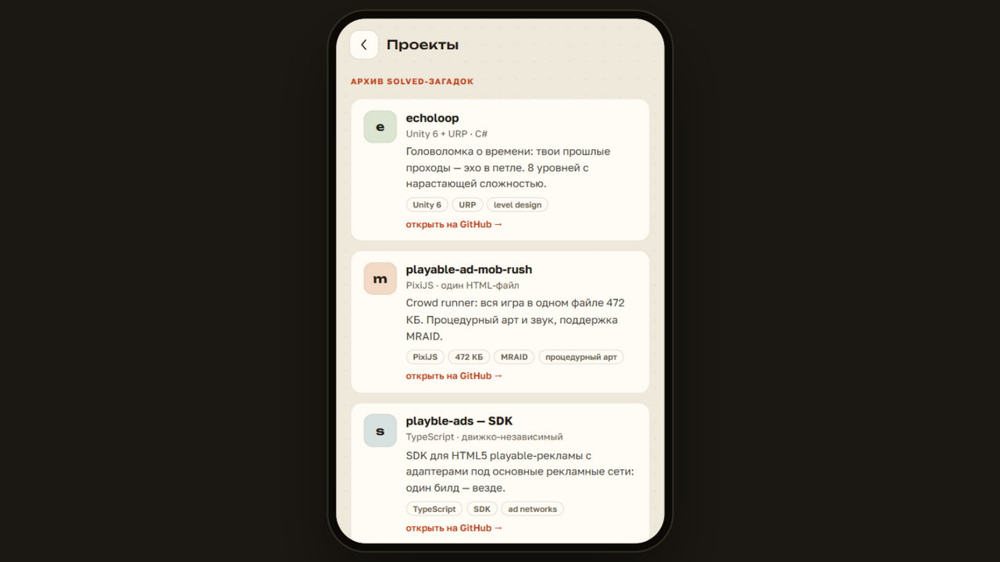
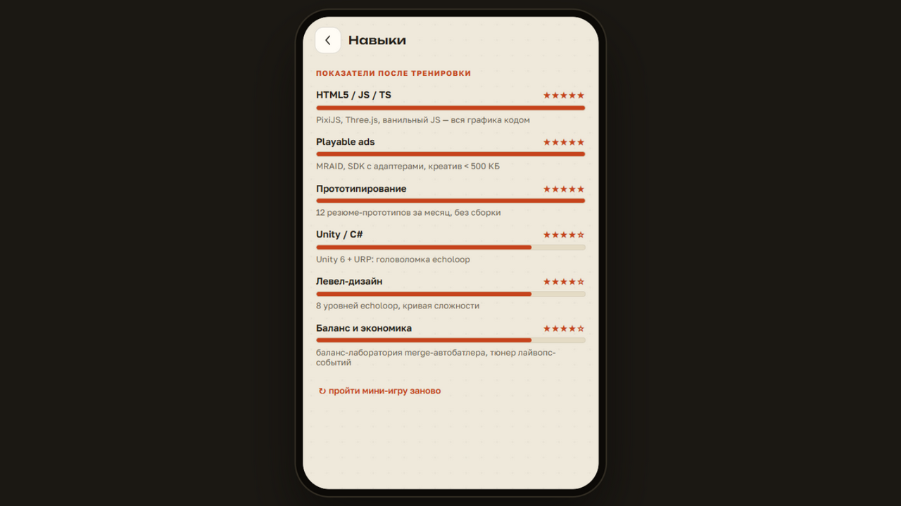
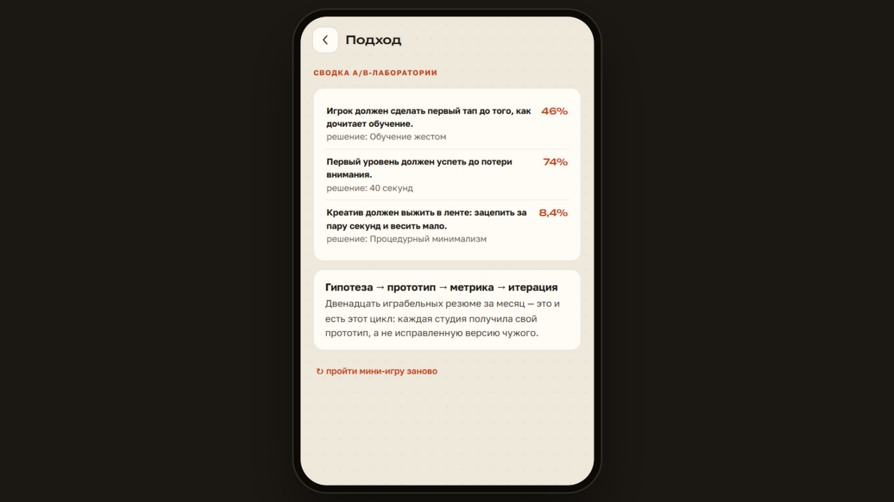
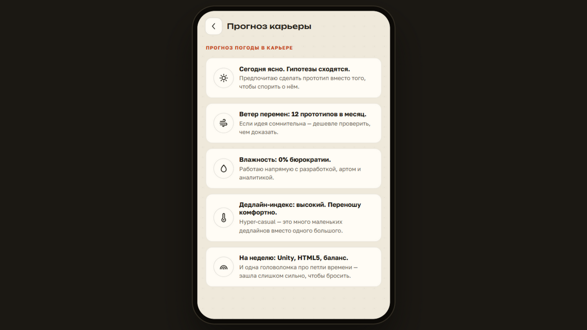
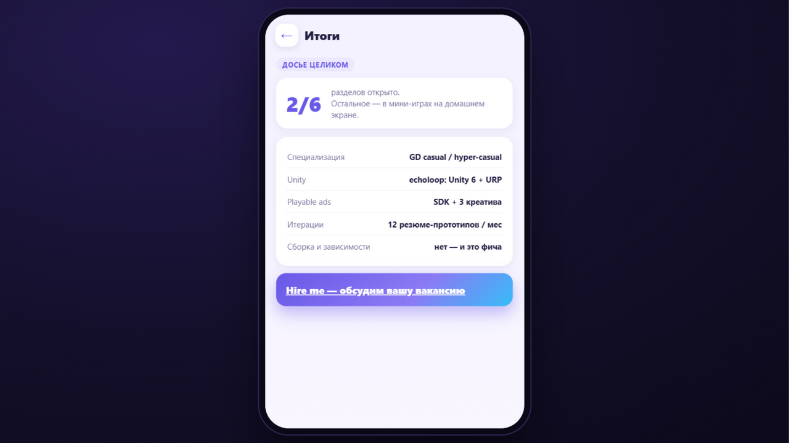

# cv-idatech — играбельное резюме для IDA TECH

Интерактивное резюме на вакансию **Game Designer (Casual / Hyper Casual)** в
IDA TECH (idatech.dev). Я сделал его в виде смартфона: HR попадает на
домашний экран, где каждое «приложение» — часть резюме, спрятанная за
мини-игрой в духе их флагмана Clever.

## Зачем

Резюме геймдизайнера — это тоже прототип на удержание. У IDA TECH портфель
мобильных аппов и brain-тренировки Clever, поэтому я подал себя их же
языком: короткие сессии, адаптивная сложность, «отчёты о прогрессе» вместо
списка достижений. Каждый экран доказывает требование вакансии делом, а не
строчкой: гипотезы и A/B — в лаборатории, level design — в кривой сложности
«Памяти», hyper-casual — в one-tap «Реакции».

## Что внутри

- 📱 **Домашний экран** — профиль, сетка приложений, док с «Итогами»,
  прогресс сохраняется в localStorage и подсвечивает пройденное галочками.
- 💭 **Память** → таймлайн опыта. Три раунда: 4 → 6 → 8 тайлов, показ
  ускоряется. Проиграть нельзя — кривая сложности мягкая.
- 🧩 **Логика** → карточки проектов. Три загадки с геймдизайнерским
  подтекстом, неверный ответ ничего не стоит.
- ⚡ **Реакция** → навыки полосками. One-tap: зона сужается, маркер
  ускоряется, промахи бесплатные.
- 🧪 **A/B Lab** → подход к работе. Три гипотезы, выбор варианта,
  смоделированные метрики (честно подписано), факты итераций.
- 🌤 **Прогноз** и 📞 **Контакты** — лёгкие аппы без геймплея.
- 🏆 **Итоги** — счётчик открытых разделов, досье и CTA.
- ⏩ **Пропустить всё** — для тех, кто не хочет играть: одна кнопка открывает
  все разделы сразу.
- 📄 **CV (PDF)** — классический одностраничный PDF (`docs/CV_Yaroslav.pdf`)
  на домашнем экране и в «Итогах».

У каждой мини-игры есть кнопка **i** — дизайн-комментарий: почему такая
кривая сложности, что это доказывает работодателю.

## Запуск

**Онлайн:** https://kerarty.github.io/cv-idatech/

Сборки и зависимостей нет — можно и просто открыть `index.html` в браузере.
Прогресс хранится в localStorage браузера. PDF-версия досье лежит рядом:
`docs/CV_Yaroslav.pdf`.

## Технологии

- Vanilla JS + HTML5 + CSS3 — без фреймворков и сборки
- DOM/CSS-анимации вместо canvas: игры простые, вес маленький
- Своя библиотека line-SVG-иконок вместо эмодзи; шрифты Unbounded и Golos Text
- Весь контент резюме — в одном конфиге `js/data.js`, механики его не знают

## Скриншоты

## Планы

- RU/EN переключатель
- Процедурный звук, как в моём playable-ad-mob-rush
- Генерация PDF-досье из «Итогов»

Полный дизайн-документ — в [GDD.md](GDD.md).
